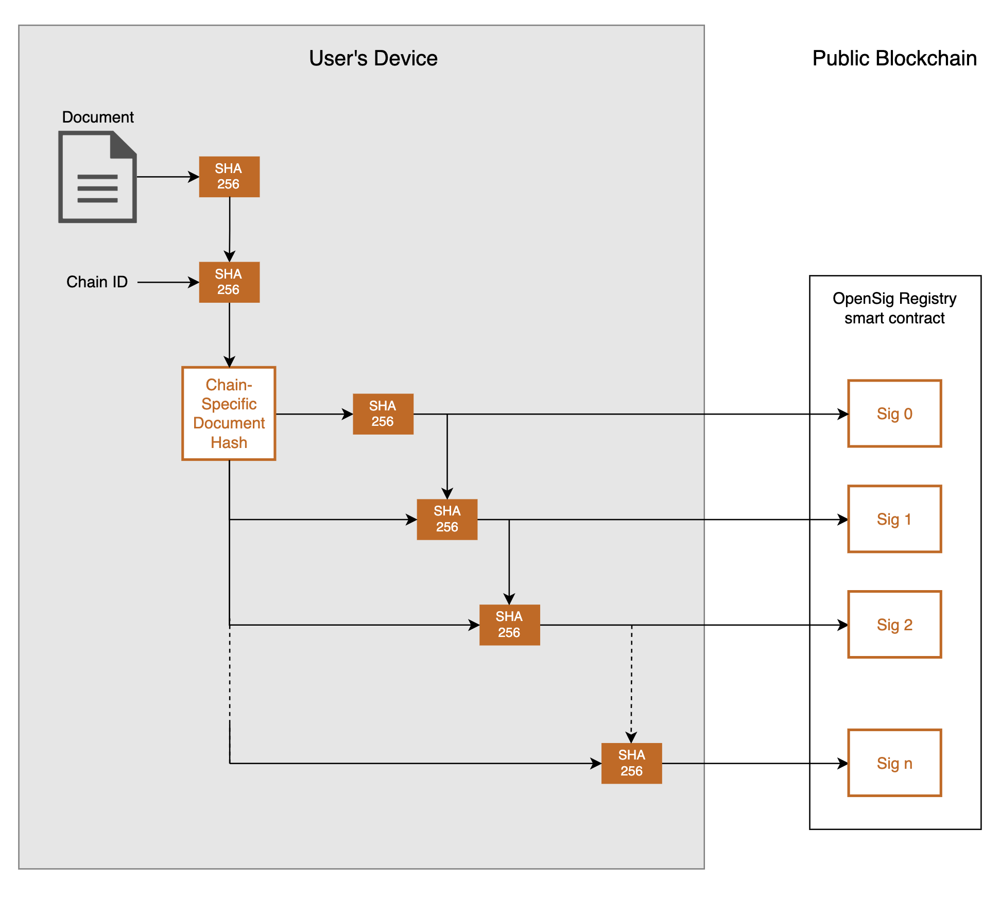

# OpenSig Standard v0.1

## Version

| Version | Description        |
|:-------:|--------------------|
| 0.1     | Initial release    |
| 0.1a    | Superficial rewrite only. No change to the standard. |

---

## Context

Digital workflows centre on files, but the integrity, authorship, and history of those files are typically managed by external systems (e.g. storage providers, communication platforms, social media platforms, or signature services).

These systems introduce implicit trust assumptions:
- verification depends on the service provider
- file history is platform-scoped
- files are usually uploaded or duplicated

OpenSig addresses this by defining a mechanism in which:

- a file remains private, local to its holder
- signature proofs are encrypted and published to a public execution layer (blockchain)
- signing and notarising become native capabilities of the user's digital identity, not 3rd party services
- verification is performed independently by any party in possession of the file

The protocol separates:
- **data** (the file, kept private)
- **proof** (derived, linked to a digital identity, publicly observable when in possession of the file)
- **verification** (performed client-side, no reliance on a specific vendor)

This enables verifiable integrity and authorship without requiring disclosure of the underlying data or reliance on a central authority.

---

## Scope

This specification defines a method for:

- generating identity-bound electronic signatures from arbitrary data files
- publishing those signatures to a public registry (e.g. EVM-based blockchain)
- deterministically discovering and verifying them

The protocol is designed such that:
- the underlying file is never revealed
- signatures cannot be linked to the file without possession of that file
- verification does not depend on a trusted intermediary

---

## Reference Implementations

See the [OpenSig GitHub](https://github.com/OpenSig) for reference implementations of this standard.

---

## Model

Let:

```
H() = SHA-256
document = arbitrary byte sequence
chainId = blockchain identifier
```

Define:

```
H_d = H(document)
H_c = H(chainId || H_d)
```

`H_d` and `H_c` MUST NOT be published.

### Signature Sequence

Signatures form a deterministic sequence:

```
Sig₀ = H(H_c)
Sigₙ = H(H_c || Sigₙ₋₁) for n > 0
```



---

## Discovery

Given `document` and `chainId`:

1. Compute `H_d`
2. Compute `H_c`
3. Iteratively derive `Sigₙ`
4. Query the registry for matching signatures
5. Stop when no further signatures are found

Ordering is derived from the sequence index, not event ordering.

### Requirements

- The client MUST derive signatures in sequence
- The client MUST NOT assume completeness without exhausting the sequence
- The client MUST validate that each discovered signature matches the expected `Sigₙ`

---

## Signing (Publication)

To publish a signature:

1. Discover the next unoccupied signature in the sequence (see [Disocvery](#discovery))
2. Encode optional payload (see [Data Encoding](#data-encoding))
3. Publish a transaction to the [registry](#registry) using the signer's identity (EOA or smart account):

```
registerSignature(Sigₙ, data)
```

### Requirements

- The client MUST publish only the next available `Sigₙ`
- The registry will reject duplicate signatures (see [Registry](#registry))

### Properties

- Publication proves existence and possession of the document at the time of signing
- Publication binds the signature and optional intent/message/data to the signer’s key
- Publication establishes ordering within the signature chain

### Notes

- Signing does not reveal the document or its hash
- Correct sequencing is enforced client-side, not by the registry
- Anonymous notarisation can be achieved by publishing with an ephemeral key

---

## Verifying

To verify a document:

1. Discover all published signatures in the sequence (see [Discovery](#discovery))
1. For each discovered signature:
   - record `signer`, `time`, and `data`
   - decode and, if applicable, decrypt the payload (see [Data Encoding](#data-encoding))

### Requirements

- The client SHOULD highlight a `Sigₙ` whose timestamp is significantly less that that of `Sigₙ₋₁` (could not simply be a symptom of blockchain race conditions) in the UI.

### Properties

- Verification requires possession of the original document
- Signature ordering is deterministic and derived from the sequence
- Verification does not require trust in the registry beyond event inclusion

### Notes

- Without `H_d`, signatures cannot be discovered or interpreted
- Payload decryption requires `H_d`
- Event ordering MUST NOT be relied upon; sequence order is derived client-side

---

## Data Encoding

Each signature MAY include a data payload.

### Header

A payload is prefixed with a 2-byte header:

```
Byte 0: version (currently 0x01)
Byte 1: flags
```

Flags:

- Bit 7: encryption flag
- Bits 0–6: data type

### Types

| Type | Value | Introduced In | Description        |
|------|-------|---------------|--------------------|
| 0    | 0x00  | version 0 | UTF-8 string           |
| 1    | 0x01  | version 0 | binary (hex)           |
| 2    | 0x02  | version 1 | object ([MsgPack](https://msgpack.org/))   |

### Encryption

If the encryption flag is set:

- Payload MUST be encrypted using AES-GCM
- Encryption key MUST be `H_d`
- A 96-bit IV MUST be prepended

Encoding:

```
[header][IV][ciphertext]
```

Big endian.

Without `H_d`, ciphertext MUST be infeasible when the encryption flag is set.

---

## Registry

The registry is a chain-specific smart contract responsible for recording published signatures and emitting events used for discovery.

Each supported execution environment MUST have exactly one registry.

### Interface (Abstract)

A registry MUST expose a method equivalent to:

```
registerSignature(signature: bytes32, data: bytes)
```

Where:

- `signature` = `Sigₙ`
- `data` = encoded payload (see [Data Encoding](#data-encoding))

The caller of `publish` is treated as the `signer`.

### Behaviour

On invocation:

1. The registry MUST revert if `signature` has already been published
2. Otherwise, the registry MUST:
   - record the signature as published
   - emit a signature event

Step 1 ensures:

- no duplication within a sequence
- resistance to replay within the same chain

### Event

The registry MUST emit an event with the following fields:

```
event Signature(
  uint256 time,
  address indexed signer,
  bytes32 indexed signature,
  bytes data
)
```

Where:

- `time` = block timestamp
- `signer` = transaction sender (or resolved identity)
- `signature` = `Sigₙ`
- `data` = optional payload

Event logs are the sole source of truth for discovery.

---

## Identity

The `signer` field MAY be:

- an EVM address
- a DID (e.g. `did:os`)

The DID method defines resolution and key binding externally to this specification.

---

## Security Properties

Given standard assumptions of SHA-256 and AES-GCM:

- **Preimage resistance**  
  `H_d` cannot be derived from published data.

- **Unlinkability**  
  Signatures cannot be associated with a document without `H_d`.

- **Sequence integrity**  
  Attack signatures cannot be inserted without breaking the chain.

- **Signer authenticity**  
  Publication requires control of the signer’s key.

- **Confidentiality (optional data)**  
  Encrypted payloads are only readable with `H_d`.

---

## Constraints

- The protocol does not define:
  - user interfaces
  - workflow semantics
  - legal interpretation of signatures
  - storage of original documents

- Implementations MUST:
  - perform hashing client-side
  - avoid exposing `H_d` or `H_c`
  - ensure correct sequence progression before publication

- Implementation SHOULD:
  - use the reference OpenSig implementation

---

## Notes

- The protocol is file-agnostic; `document` is treated as a byte array.
- Signature discovery is linear in the number of signatures.
- Indexing MAY be used to optimise discovery but MUST NOT alter correctness.

---

## License

[Creative Commons Attribution 4.0 International License (CC BY 4.0)](https://creativecommons.org/licenses/by/4.0/)

© OpenSig